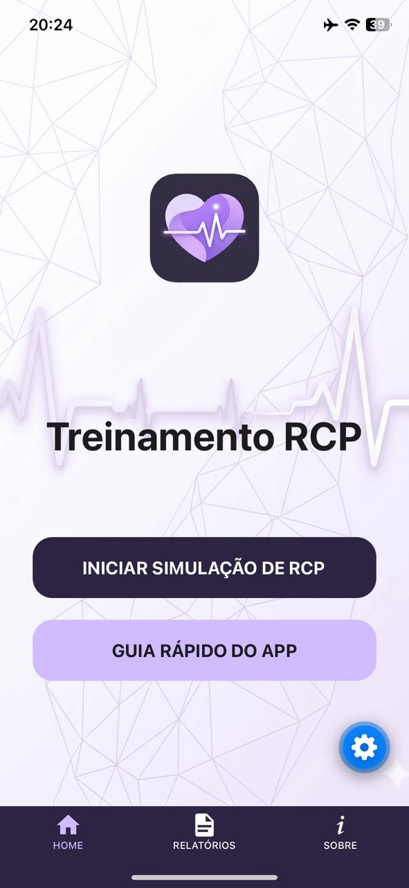
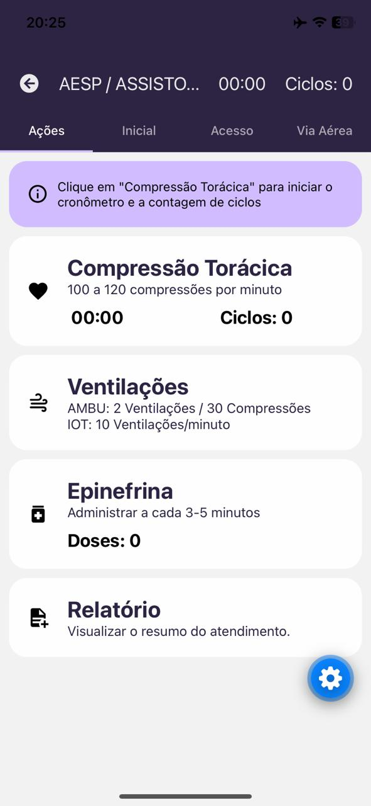
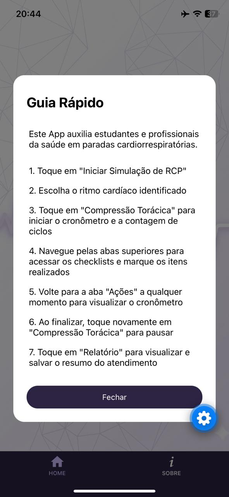

# App RCP

Aplicativo mobile em React Native para treinamento de RCP, voltado a estudantes da área da saúde. Está sendo refeito a partir do meu TCC, como projeto pessoal para praticar e aprender.

Inclui os fluxos de atendimento para AESP/assistolia e FV/TVSP.

> Status: em desenvolvimento.

## Telas

  

## Tecnologias

- React Native com Expo
- Expo Router e React Navigation (navegação entre telas)
- TypeScript
- React Native Reanimated e Expo Haptics

## Como rodar

1. `npm install`
2. `npx expo start`
3. Abra no celular com o app Expo Go, ou em um emulador.
